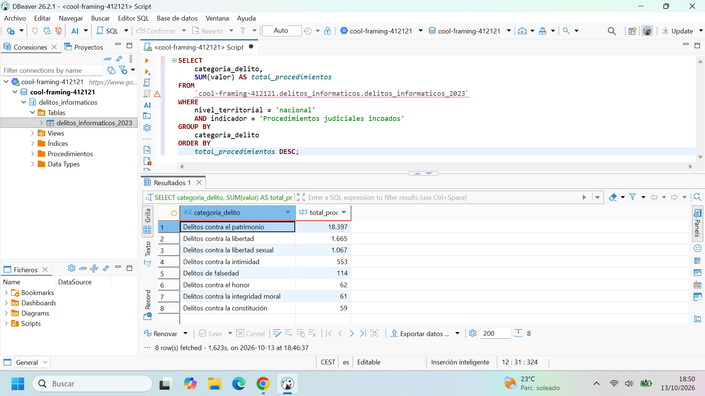

# Análisis de delitos informáticos en España (2023)

Proyecto de preparación y análisis de datos públicos sobre criminalidad informática en España. El trabajo transforma una hoja de cálculo con estructura jerárquica y formato ancho en una tabla analítica, reproducible y preparada para consultas SQL en Google BigQuery.

## Objetivo

Construir una base de datos que permita analizar la actividad judicial relacionada con delitos informáticos por categoría delictiva, indicador y nivel territorial durante 2023.

La primera pregunta analítica del proyecto es:

> ¿Qué categorías de delitos informáticos registraron más procedimientos judiciales incoados en España durante 2023?

## Fuente de los datos

- **Organismo:** Fiscalía General del Estado.
- **Publicación:** Memoria de la Fiscalía General del Estado 2024, con información estadística correspondiente a 2023.
- **Archivo de trabajo:** `Compendios_especialidades_2023.xlsx`.
- **Hoja utilizada:** `CA_DelitosInf`.
- **Fuente oficial:** [Memoria de la Fiscalía General del Estado 2024](https://www.fiscal.es/memorias/memoria2024/FISCALIA_SITE/index.html).

## Problema de datos

La hoja original no tenía una estructura tabular adecuada para análisis. Contenía 186 columnas, encabezados distribuidos en varias filas, celdas combinadas, bloques separados por comunidades autónomas y valores provinciales, autonómicos y nacionales dentro de una misma matriz.

Para evitar errores de agregación era necesario distinguir los tres niveles territoriales. De lo contrario, una consulta podría sumar simultáneamente provincias, comunidades autónomas y el total nacional, duplicando los datos.

## Proceso realizado

1. Selección de la hoja de delitos informáticos del archivo original.
2. Identificación de categorías, tipos de delito, indicadores y territorios.
3. Transformación del formato ancho a formato largo.
4. Normalización de nombres territoriales y creación del campo `nivel_territorial`.
5. Conservación de los valores no informados como nulos, sin convertirlos en cero.
6. Validación de filas, tipos de datos, duplicados y coherencia territorial.
7. Exportación del conjunto limpio a CSV.
8. Carga en Google BigQuery mediante Python.
9. Ejecución de consultas SQL en BigQuery Studio y DBeaver.

## Tabla final

La tabla `delitos_informaticos_2023` contiene **4.148 registros y 8 columnas**.

| Campo | Tipo | Descripción |
|---|---|---|
| `anio` | INTEGER | Año de referencia. |
| `comunidad_autonoma` | STRING | Comunidad autónoma asociada al registro. Es nulo para el total nacional. |
| `nivel_territorial` | STRING | Nivel del dato: provincia, comunidad autónoma o nacional. |
| `territorio` | STRING | Nombre del territorio correspondiente. |
| `categoria_delito` | STRING | Agrupación general de delitos. |
| `tipo_delito` | STRING | Tipo específico de delito informático. |
| `indicador` | STRING | Medida registrada, como procedimientos, calificaciones o sentencias. |
| `valor` | INTEGER | Valor numérico informado. Puede ser nulo cuando la fuente no proporciona el dato. |

### Validación por nivel territorial

| Nivel territorial | Filas | Valores informados | Valores nulos |
|---|---:|---:|---:|
| Provincia | 2.924 | 2.287 | 637 |
| Comunidad autónoma | 1.156 | 1.030 | 126 |
| Nacional | 68 | 68 | 0 |
| **Total** | **4.148** | **3.385** | **763** |

## BigQuery

- **Proyecto:** `cool-framing-412121`
- **Dataset:** `delitos_informaticos`
- **Tabla:** `delitos_informaticos_2023`
- **Ubicación:** `EU`

La carga se realizó desde un DataFrame de Pandas mediante el cliente oficial de BigQuery. El esquema se definió de forma explícita y la configuración `WRITE_EMPTY` evitó sobrescribir accidentalmente una tabla existente.

## Consultas SQL

La carpeta [`sql`](sql/) contiene las primeras consultas reproducibles:

- [`01_validacion_total_registros.sql`](sql/01_validacion_total_registros.sql): verifica que la tabla contenga 4.148 registros.
- [`02_procedimientos_nacionales_por_categoria.sql`](sql/02_procedimientos_nacionales_por_categoria.sql): agrega los procedimientos judiciales incoados por categoría delictiva usando exclusivamente el nivel nacional.

## Primer resultado

Los delitos contra el patrimonio concentran el mayor número de procedimientos judiciales incoados en el nivel nacional durante 2023.

| Categoría delictiva | Procedimientos judiciales incoados |
|---|---:|
| Delitos contra el patrimonio | 18.397 |
| Delitos contra la libertad | 1.665 |
| Delitos contra la libertad sexual | 1.067 |
| Delitos contra la intimidad | 553 |
| Delitos de falsedad | 114 |
| Delitos contra el honor | 62 |
| Delitos contra la integridad moral | 61 |
| Delitos contra la constitución | 59 |

> Estos valores representan procedimientos judiciales incoados. No equivalen necesariamente al número de delitos cometidos ni al número de personas afectadas.

La conexión entre DBeaver y BigQuery también se validó ejecutando la consulta directamente sobre la tabla alojada en la nube:



## Estructura del proyecto

```text
proyecto3_delitos_informaticos_bigquery/
├── data/
│   ├── raw/
│   │   └── Compendios_especialidades_2023.xlsx
│   └── processed/
│       └── delitos_informaticos_2023_limpio.csv
├── notebooks/
│   └── limpieza_delitos_informaticos_2023.ipynb
├── sql/
│   ├── 01_validacion_total_registros.sql
│   └── 02_procedimientos_nacionales_por_categoria.sql
├── visualizaciones/
└── README.md
```

## Tecnologías utilizadas

- Python
- Pandas
- Google Colab
- Google BigQuery
- SQL
- DBeaver
- Git y GitHub

## Reproducción

1. Descargar el archivo original desde la fuente oficial.
2. Ejecutar `notebooks/limpieza_delitos_informaticos_2023.ipynb`.
3. Revisar el CSV generado en `data/`.
4. Crear un dataset en BigQuery y actualizar el identificador del proyecto si es necesario.
5. Ejecutar las consultas de la carpeta `sql/`.

## Próximos pasos

- Ampliar las consultas para comparar comunidades autónomas y provincias.
- Analizar otros indicadores, como calificaciones y sentencias condenatorias.
- Construir una visualización final con el análisis territorial.

