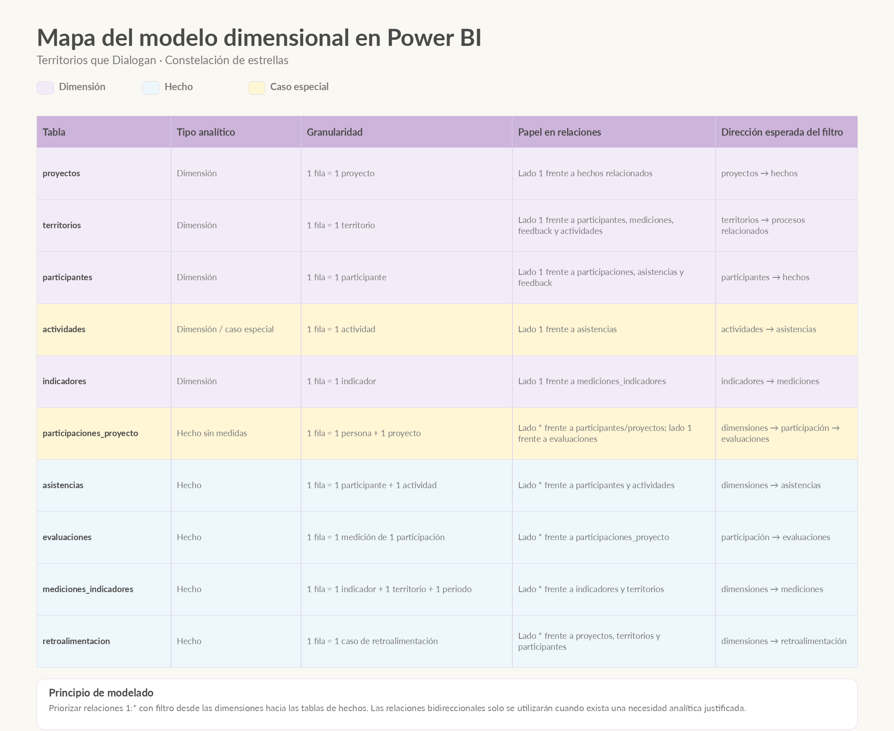

# Modelo dimensional en Power BI

## 1. Propósito

La base de datos de **Territorios que Dialogan** fue diseñada originalmente en TiDB como un modelo relacional normalizado.

Ese diseño prioriza:

- integridad referencial;
- reducción de redundancias;
- consistencia;
- almacenamiento estructurado;
- mantenimiento de los datos.

Sin embargo, el objetivo de Power BI es diferente.

En la capa de Business Intelligence interesa facilitar:

- análisis;
- agregaciones;
- filtrado;
- creación de indicadores;
- comparación entre grupos;
- construcción de visualizaciones.

Por este motivo, el modelo importado desde TiDB no se reproduce de manera automática como modelo analítico definitivo.

En Power BI se reorganiza siguiendo principios de **modelado dimensional**.

---

# 2. De modelo relacional a modelo dimensional

El flujo general del proyecto puede entenderse así:

```text
TiDB
│
│  Modelo relacional normalizado
│  orientado al almacenamiento
│
↓
Power BI
│
│  Modelo dimensional
│  orientado al análisis
│
↓
DAX
│
↓
Visualización y storytelling
```

Esto no significa que el modelo SQL estuviera mal diseñado.

Los dos modelos responden a necesidades diferentes.

```text
Modelo relacional normalizado
→ optimiza almacenamiento, integridad y operación

Modelo dimensional
→ optimiza análisis, agregación y visualización
```

---

# 3. Estructura dimensional del proyecto

El proyecto contiene varios procesos analíticos diferentes:

```text
participación
asistencia
evaluación
indicadores
accountability
```

Por esta razón, el modelo no se plantea como una única estrella.

La estructura se aproxima a una:

**Constelación de estrellas o Fact Constellation**

Es decir, varias tablas de hechos comparten dimensiones comunes.

---

# 4. Dimensiones

Las dimensiones describen el contexto en el que ocurren los hechos.

Permiten responder preguntas como:

```text
¿quién?
¿dónde?
¿qué proyecto?
¿qué actividad?
¿qué indicador?
¿cuándo?
```

Las dimensiones principales identificadas inicialmente son:

```text
proyectos
territorios
participantes
actividades
indicadores
```

Posteriormente se incorporará también una dimensión específica de fecha:

```text
DimFecha
```

para centralizar el análisis temporal.

---

# 5. Tablas de hechos

Las tablas de hechos representan eventos, relaciones o procesos que interesa analizar.

En el modelo se identifican inicialmente:

```text
participaciones_proyecto
asistencias
evaluaciones
mediciones_indicadores
retroalimentacion
```

Cada una responde a una granularidad diferente.

---

# 6. Granularidad

Antes de definir relaciones o medidas, se establece qué representa exactamente una fila en cada tabla.

```text
participaciones_proyecto
1 fila = 1 persona vinculada a 1 proyecto

asistencias
1 fila = 1 participante relacionado con 1 actividad

evaluaciones
1 fila = 1 medición de 1 participación

mediciones_indicadores
1 fila = 1 indicador + 1 territorio + 1 periodo

retroalimentacion
1 fila = 1 caso de retroalimentación
```

La granularidad determina qué puede contarse, agregarse o compararse correctamente.

Un ejemplo importante del proyecto es:

```text
320 participaciones
≠
300 participantes únicos
```

porque una persona puede estar vinculada a más de un proyecto.

---

# 7. Mapa de clasificación del modelo

La siguiente visual resume el papel analítico inicial de las tablas, su granularidad y la dirección esperada de los filtros.

<p align="center">
  
</p>

La codificación de color utilizada es:

```text
Lila
→ dimensiones

Azul
→ tablas de hechos

Amarillo
→ tablas que requieren una consideración especial
```

El color se utiliza como recurso de agrupación semántica y no únicamente como elemento decorativo.

---

# 8. Participaciones como Factless Fact Table

`participaciones_proyecto` representa un caso especialmente interesante.

Su granularidad es:

```text
1 fila
=
1 persona + 1 proyecto
```

La tabla no necesita contener una medida numérica como importe, cantidad o duración para funcionar como tabla de hechos.

La propia existencia de la fila representa un hecho:

```text
una persona participa en un proyecto
```

Por esta razón puede interpretarse como una:

**Factless Fact Table**

o tabla de hechos sin medidas.

Las participaciones pueden analizarse mediante el conteo de filas, participantes únicos, proyectos por persona, permanencia o retirada.

---

# 9. El caso especial de actividades

La tabla `actividades` requiere una consideración adicional.

Su granularidad es:

```text
1 fila = 1 actividad
```

Cuando el proceso analizado es la asistencia:

```text
actividades
      1
      │
      ↓
      *
asistencias
```

`actividades` funciona como una dimensión porque describe el contexto de la asistencia mediante atributos como:

```text
nombre
tipo
modalidad
territorio
proyecto
fecha
```

Sin embargo, la propia actividad también contiene información cuantitativa:

```text
costo_planificado
costo_real
duracion_horas
meta_participantes
```

Por tanto, si posteriormente se realiza un análisis específico de implementación, costes o cumplimiento de metas, puede ser necesario reconsiderar su tratamiento analítico.

La clasificación depende de:

```text
granularidad
+
pregunta analítica
```

y no únicamente del nombre de la tabla.

---

# 10. Cardinalidad

El modelo prioriza relaciones:

```text
1 : *
```

El lado `1` corresponde normalmente a la dimensión.

El lado `*` corresponde normalmente a la tabla de hechos.

Ejemplo:

```text
proyectos
    1
    │
    ↓
    *
participaciones_proyecto
```

Un proyecto puede tener muchas participaciones.

Cada participación pertenece a un único proyecto.

---

# 11. Dirección de los filtros

Como principio general, se prioriza el flujo:

```text
DIMENSIÓN
    ↓
HECHO
```

Por ejemplo:

```text
proyectos
    ↓
participaciones_proyecto
```

Si se selecciona:

```text
P02
```

el filtro debe aplicarse a las participaciones pertenecientes a P02.

De igual forma:

```text
participantes
    ↓
asistencias
```

permite analizar las asistencias según atributos como sexo, rango de edad o grupo poblacional.

---

# 12. Relaciones bidireccionales

Las relaciones bidireccionales no se utilizarán de forma predeterminada.

Aunque Power BI permite:

```text
A ↔ B
```

este tipo de relación puede introducir:

```text
ambigüedad
rutas alternativas de filtrado
mayor complejidad
resultados difíciles de interpretar
```

Por ello se seguirá la regla:

> Utilizar relaciones `1:*` con filtro desde dimensiones hacia hechos y recurrir al filtrado bidireccional únicamente cuando exista una necesidad analítica claramente justificada.

---

# 13. Dimensiones compartidas

Algunas dimensiones participan en varios procesos analíticos.

Por ejemplo:

```text
                    proyectos
                        │
          ┌─────────────┼──────────────┐
          ↓             ↓              ↓
participaciones   evaluaciones   retroalimentacion
```

y:

```text
                   participantes
                        │
          ┌─────────────┼──────────────┐
          ↓             ↓              ↓
participaciones     asistencias   retroalimentacion
```

Estas dimensiones compartidas permiten analizar distintos procesos utilizando definiciones comunes.

Este concepto se conoce como:

**dimensión conformada o Conformed Dimension**.

---

# 14. Estrella de participación

Una de las estructuras dimensionales iniciales puede representarse así:

```text
        proyectos
            1
            │
            ↓
            *
participaciones_proyecto
            *
            ↑
            │
            1
       participantes
```

La tabla central registra la relación persona-proyecto.

Las dimensiones permiten analizar estas participaciones por proyecto y características de las personas.

---

# 15. Estrella de asistencia

Para analizar asistencia:

```text
        actividades
            1
            │
            ↓
            *
        asistencias
            *
            ↑
            │
            1
       participantes
```

La tabla `asistencias` registra el evento.

`actividades` y `participantes` proporcionan el contexto.

---

# 16. Estrella de indicadores

La estructura de medición de indicadores es especialmente clara:

```text
        indicadores
            1
            │
            ↓
            *
mediciones_indicadores
            *
            ↑
            │
            1
        territorios
```

La granularidad de la tabla de hechos es:

```text
1 indicador
+
1 territorio
+
1 periodo
```

Esta estructura es importante para evitar comparar métricas que se encuentran en distintos niveles de agregación.

---

# 17. Accountability

La tabla `retroalimentacion` funciona como tabla de hechos del componente de Accountability.

Cada fila representa:

```text
1 caso de retroalimentación
```

Puede analizarse mediante dimensiones como:

```text
proyecto
territorio
participante
```

La relación con participantes es opcional porque algunos casos son anónimos.

Esto significa que:

```text
id_participante = NULL
```

puede ser un valor válido dentro de este proceso.

---

# 18. Evaluación longitudinal

`evaluaciones` registra mediciones asociadas a una participación concreta.

La relación actual es:

```text
participantes
      ↓
participaciones_proyecto
      ↓
evaluaciones
```

La granularidad es:

```text
1 fila
=
1 medición de 1 participación
```

Esto permite distinguir correctamente evaluaciones de una misma persona cuando participa en proyectos diferentes.

Las principales mediciones utilizadas son:

```text
Baseline
Endline
```

y permiten estudiar cambios en:

```text
conocimientos
confianza
convivencia
```

---

# 19. Dimensión de fecha

El modelo incorporará una dimensión específica:

```text
DimFecha
```

para centralizar el análisis temporal.

Esta dimensión permitirá disponer de atributos como:

```text
fecha
año
mes
número de mes
trimestre
semana
```

El proyecto contiene diferentes tipos de fecha:

```text
fecha de inscripción
fecha de salida
fecha de actividad
fecha de evaluación
fecha de medición
fecha de recepción
fecha de respuesta
```

Por ello será necesario definir qué relaciones temporales permanecen activas y cuáles se utilizan de manera alternativa mediante DAX.

---

# 20. Diferencia entre el modelo SQL y el modelo Power BI

El modelo de TiDB y el modelo de Power BI no tienen exactamente el mismo objetivo.

```text
TiDB
→ almacenar correctamente

Power BI
→ analizar correctamente
```

Por esta razón, importar las tablas y relaciones desde SQL no significa que el modelo dimensional esté terminado.

Power BI puede detectar relaciones existentes, pero el diseño analítico debe revisarse de forma explícita.

Antes de aceptar una relación se comprobará:

```text
¿Qué representa una fila en cada tabla?

¿Cuál es el lado único?

¿Cuál es el lado muchos?

¿En qué dirección debería viajar el filtro?
```

---

# 21. Arquitectura analítica esperada

La estructura general puede entenderse como una constelación:

```text
                 DIMENSIONES COMPARTIDAS

        Proyecto · Participante · Territorio
          Actividad · Indicador · Fecha

                       ↓

              VARIAS ESTRELLAS

       Participación
       Asistencia
       Evaluación
       Indicadores
       Accountability
```

Esto permite mantener separadas las distintas granularidades y, al mismo tiempo, utilizar dimensiones comunes para cruzar perspectivas analíticas.

---

# 22. Principios adoptados para Power BI

El modelo seguirá estos criterios:

```text
Granularidad definida antes de crear medidas

Dimensiones en el lado 1

Hechos en el lado *

Filtros preferentemente:
dimensión → hecho

Evitar relaciones muchos a muchos cuando no sean necesarias

Evitar filtros bidireccionales sin justificación

Utilizar dimensiones compartidas cuando sea posible

Crear una DimFecha específica

Separar posteriormente las medidas DAX
en una tabla dedicada
```

---

# 23. Organización de las medidas DAX

Las medidas no se almacenarán de forma dispersa entre las tablas del modelo.

Se creará una tabla específica:

```text
_Medidas
```

y posteriormente se utilizarán carpetas de presentación como:

```text
01 · General
02 · Monitoring
03 · Evaluation
04 · Accountability
```

Esto permite mantener separado:

```text
modelo de datos
≠
capa de medidas
```

y facilita el mantenimiento del proyecto.

---

# 24. Estado actual del modelo

En esta fase:

```text
✓ las diez tablas fueron importadas desde TiDB

✓ los tipos de datos fueron revisados en Power Query

✓ las columnas de navegación automáticas fueron eliminadas

✓ se identificó la granularidad de cada tabla

✓ se realizó una clasificación inicial entre hechos y dimensiones

✓ se definió como principio el filtrado dimensión → hecho

→ queda pendiente reorganizar y validar las relaciones
  en la Vista Modelo

→ queda pendiente crear DimFecha

→ queda pendiente crear la tabla _Medidas

→ queda pendiente construir la capa DAX
```

---

# 25. Idea central

El objetivo no es copiar el modelo SQL dentro de Power BI.

El objetivo es transformar una estructura relacional diseñada para almacenar datos en una estructura dimensional diseñada para analizarlos.

```text
MODELO RELACIONAL NORMALIZADO
            ↓
     capa analítica
            ↓
MODELO DIMENSIONAL
            ↓
CONSTELACIÓN DE ESTRELLAS
            ↓
DAX
            ↓
VISUALIZACIÓN
```

La pregunta que guía el diseño sigue siendo:

```text
¿Qué representa exactamente una fila?
```

A partir de esa respuesta se pueden definir correctamente:

```text
hechos
dimensiones
cardinalidades
direcciones de filtro
medidas
visualizaciones
```