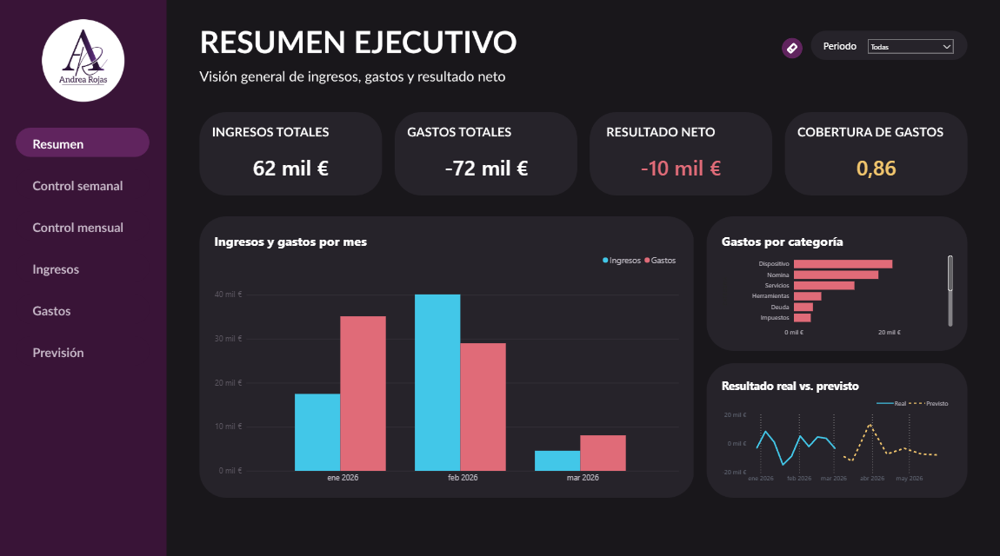

# Dashboard financiero en Power BI

Proyecto desarrollado durante mis prácticas profesionales y posteriormente rediseñado para mi portafolio. Esta versión utiliza datos anonimizados.

El informe permite explorar ingresos, gastos y resultado neto, seguir su evolución temporal y comparar datos reales con previsiones.

## Vista general

## Objetivo

Facilitar el seguimiento financiero mediante indicadores y visualizaciones que ayuden a responder:

- ¿Los ingresos cubren los gastos del período seleccionado?
- ¿Cómo evolucionan los ingresos y los gastos?
- ¿Qué categorías concentran el gasto?
- ¿Cómo se compara el resultado real con el previsto?

## Indicadores principales

| Indicador | Utilidad |
| --- | --- |
| Ingresos totales | Consultar los ingresos del período seleccionado. |
| Gastos totales | Consultar los gastos del período seleccionado. |
| Resultado neto | Identificar el balance entre ingresos y gastos. |
| Cobertura de gastos | Valorar en qué medida los ingresos cubren los gastos. |

## Páginas del informe

| Página | Enfoque |
| --- | --- |
| Resumen | Visión ejecutiva de los principales indicadores financieros. |
| Control semanal | Seguimiento financiero por semana. |
| Control mensual | Seguimiento financiero por mes. |
| Ingresos | Análisis específico de los ingresos. |
| Gastos | Análisis específico de los gastos. |
| Previsión | Exploración de las previsiones financieras. |

## Trabajo realizado

- Preparación y transformación de datos con Power Query.
- Creación de medidas DAX para el análisis financiero.
- Construcción de visualizaciones para analizar la evolución temporal y la distribución del gasto.
- Incorporación de filtros y navegación entre páginas.
- Rediseño visual para mejorar la jerarquía de la información y la coherencia del informe.
- Anonimización de los datos para su presentación en el portafolio.

## Herramientas

Power BI Desktop · Power Query · DAX

## Consultar el dashboard

[Descargar el archivo de Power BI](Dashboard_Financiero_Rediseno.pbix)

Para explorar el informe, descarga el archivo y ábrelo en Power BI Desktop.

Los importes y resultados corresponden a la versión anonimizada utilizada con fines demostrativos.
